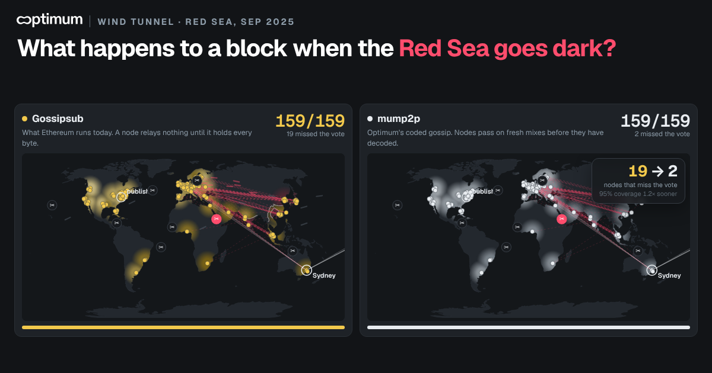

# Optimum Wind Tunnel

**What happens to a block when the Red Sea goes dark?**

An interactive simulation that runs Optimum's **mump2p** (RLNC coded gossip) and libp2p **Gossipsub** over the same network laid on real cities, fibre distances and undersea cable corridors.



## What makes it different

* **Side by side on the real world.** Gossipsub on the left, mump2p on the right, the same block on the same Earth at the same moment, with live counters of who has it and who missed the vote. Switch to *Who wins where* for a difference map.
* **Share your run.** One click posts the scenario result to X with a link straight back to it.
* **A 60 second guided tour** walks first time visitors through the story: one block, Gossipsub waiting for the whole thing, mump2p relaying from the first shard, the probe decoding inside Sydney, a Red Sea cable cut, and finer shards. Every technical term has a `?` explanation.
* **Your own file is really coded.** Drop an image or type a message. It is split into *k* fragments and every shard carries a random coefficient vector over GF(2⁸). Relays recode without decoding. The probe runs Gaussian elimination on the actual bytes, and the decoded image matches the source pixel for pixel.
* **Probe any node.** Watch its coefficient matrix fill in echelon form, see shards arrive with Optimum's own trace names (`NEW_SHARD`, `UNHELPFUL_SHARD`), and see the image stay noise until the *k*th independent shard, then resolve at once. The Gossipsub side shows the store and forward wait for the whole block.
* **Real geography.** 160 nodes in 38 hosting hubs, latency from great circle distance at fibre speed, bandwidth split 20% at 1 Gbps / 80% at 50 Mbps as in the OptimumP2P paper's Ethshadow runs.
* **Sabotage.** Cut eight real cable corridors (Red Sea, Baltic, Transatlantic…) or black out a city.
* **Missed votes, not a race bar.** The headline result is how many nodes get the block after the 4 s attestation deadline. Arrival time is drawn like a weather map, with the deadline as a contour, plus a "who wins where" difference map.
* **Listen in stereo.** Gossipsub plays in the left ear, mump2p in the right: useful arrivals are notes pitched by longitude, wasted copies a dull thud.

## Fairness

Defaults follow Optimum's published dev setup (k = 4 shards). Raising k widens the gap; the extra CPU and header cost of more shards is not modelled, and the page says so.


Both protocols get the same peers, links, loss and reliable transport (a lost packet costs a retransmit for both). Coding helps because a node never waits for one particular shard.

**Not modelled:** CPU for validation and decoding, QUIC, peer scoring, signature checks, the real mainnet mesh. This is a simulation, not a benchmark.

## Scenario links

Append a scenario to the URL: `#red`, `#baltic`, `#dc`, `#islands`, `#storm`, `#blob`, `#calm`.

## Build

`index.html` is a single self-contained file (no runtime dependencies besides Google Fonts).

```
cd src
npm install
npm run map     # only if you change the map or cities
npm run build   # writes ../index.html
```

## Sources

* [OptimumP2P paper (arXiv 2508.04833)](https://arxiv.org/abs/2508.04833)
* [mump2p docs](https://docs.getoptimum.xyz/docs/learn/overview/p2p)
* [optimum-dev-setup-guide defaults](https://github.com/getoptimum/optimum-dev-setup-guide)
* [Lido PERCH test of mump2p](https://research.lido.fi/t/perch-request-for-node-operators-to-run-and-test-optimum-mump2p/11786)
* Map data: [Natural Earth](https://www.naturalearthdata.com/) via [world-atlas](https://github.com/topojson/world-atlas)

Fan-made by **ecamli** for the Optimum community. Not an official Optimum product.
